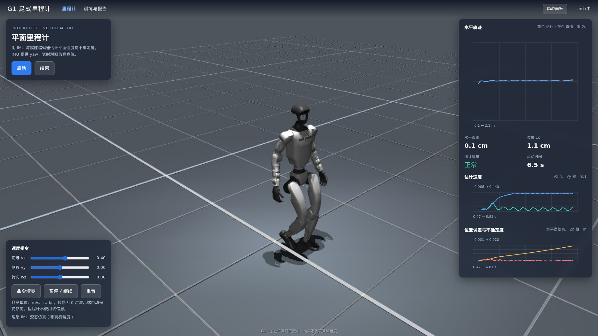

# g1-odom：G1 神经网络足式里程计

[文档](docs/) · [评测报告](reports/report.md) · [使用方法](docs/usage.md) · [方法说明](docs/method.md) · [开发与复现](docs/development.md)

Unitree G1 29 自由度机器人的平面里程计。输入原始 IMU 和八个髋膝编码器，网络输出骨盆航向坐标系下的 vx、vy 及其不确定度；
航向直接读取硬件 IMU 提供的 yaw，积分得到 x、y、yaw 与位姿协方差。

> 全部训练与评测数据由 G1 仿真生成；Web 演示和测试用理想仿真姿态模拟 IMU 的 yaw，页面和报告都有标注。
> 结果不代表宇树真机精度。

## 结果

| 测试集（锁定权重后评测一次） | 终点均值 | 位姿 2σ 覆盖 |
|---|---:|---:|
| test_iid（100 条） | 2.76 cm | 96.2% |
| odometry（30 条 × 90 s） | 2.65 cm | 99.9% |
| stop_test（60 条启停） | 2.23 cm | 96.2% |

分布外组合工况 `test_ood`（低摩擦、重负载、低刚度、扭矩折减，60 条中 23 条跌倒）误差明显更大，协方差也偏小；
但这时种子间分歧会触发 `quality` 告警（41.3% 的帧为 warn/alarm，test_iid 只有 1.1%），区分分布内外的 AUROC 为 0.991。
完整结果见 [reports/report.md](reports/report.md)。



## 快速开始

仅使用已发布模型做推理，只需要 `numpy`、`scipy`、`onnxruntime`：

```bash
git clone <repo-url> g1_odometry && cd g1_odometry
pip install -e .
```

```python
from g1_odom.runtime import Odometry
from g1_odom.sensors import SensorSample

odom = Odometry()   # 默认加载 releases/estimator.onnx
# yaw：硬件 IMU 输出、已变换到骨盆坐标系的姿态 yaw，单位 rad
result = odom.update(SensorSample(t, gyro, accel, q, dq, imu_yaw=yaw, imu_yaw_t=t))
# result 为 None（尚未就绪）或含 velocity / pose / pose_cov / uncertainty / quality 的字典
```

输入输出约定、坐标系和注意事项见 [docs/usage.md](docs/usage.md)。

## 完整环境（仿真、训练、Web）

没有 NVIDIA GPU 时用 CPU 环境（Python 3.12、uv、Linux，渲染需要系统库 `libosmesa6`）：

```bash
bash scripts/bootstrap-cpu.sh  # CPU 版 PyTorch，不安装 nvidia / CUDA 包
.venv/bin/python -m g1_odom fetch --verify
OPENBLAS_NUM_THREADS=1 .venv/bin/python -m pytest
scripts/run_web.sh             # http://127.0.0.1:18078
```

有匹配驱动的 NVIDIA GPU 时，仍可用 `bash scripts/bootstrap.sh`（按 `requirements-lock.txt` 安装 CUDA 版 PyTorch）。

常用命令（也可用 `g1-odom <command>`）：

| 命令 | 作用 |
|---|---|
| `python -m g1_odom run --device cpu` | 采集 → 审计 → 训练 → 校准 → 评测，每个阶段可中断恢复 |
| `python -m g1_odom collect` | 只采集仿真数据 |
| `python -m g1_odom serve` | 启动 Web 控制台 |
| `python -m g1_odom fetch --verify` | 校验 `assets/unitree_g1/` 与锁定哈希一致 |

复现步骤、各阶段说明和资源配置见 [docs/development.md](docs/development.md)。

## 目录结构

```text
.
├── src/g1_odom/        Python 包
│   ├── runtime.py        推理入口 Odometry（只依赖 numpy / scipy / onnxruntime）
│   ├── sensors.py        传感器样本、特征构造、重力标定
│   ├── uncertainty.py    不确定度校准与位姿协方差传播
│   ├── standstill.py     静止检测
│   ├── simulation.py     MuJoCo G1 仿真
│   ├── dataset.py        数据采集与审计
│   ├── labels.py         速度标签构造
│   ├── model.py, trainer.py, train.py   网络、训练、导出与校准
│   ├── evaluate.py       评测与报告生成
│   ├── workflow.py       端到端流程
│   ├── serve.py, live.py, web/          Web 控制台
│   └── __main__.py       命令行入口
├── tests/              pytest 测试
├── scripts/            bootstrap、资源校验、Web 冒烟测试、启动脚本
├── configs/            资源配置示例与资源锁定清单（assets.lock.json）
├── assets/unitree_g1/  随仓库提供的 G1 模型、网格和步行策略（见 NOTICE.md）
├── releases/           发布的 ONNX 模型、校准参数与元数据
├── reports/            评测报告与各阶段审计结果
├── docs/               使用、方法与开发文档
└── data/ runs/ outputs/   本地生成目录（Git 忽略）
```

## 许可证与第三方资源

本项目代码、发布的模型与文档采用 [Apache License 2.0](LICENSE)。该许可证**不适用于** `assets/unitree_g1/` 里的宇树机器人模型和步行策略，
其来源和条款说明见 [NOTICE.md](NOTICE.md)。训练数据、依赖、检查点和运行文件都被 Git 忽略，发布的 ONNX、源码、配置和报告可以纳入 Git。

欢迎贡献，请先阅读 [CONTRIBUTING.md](CONTRIBUTING.md)。
