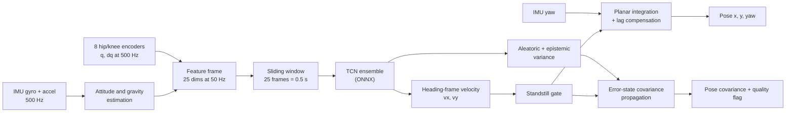
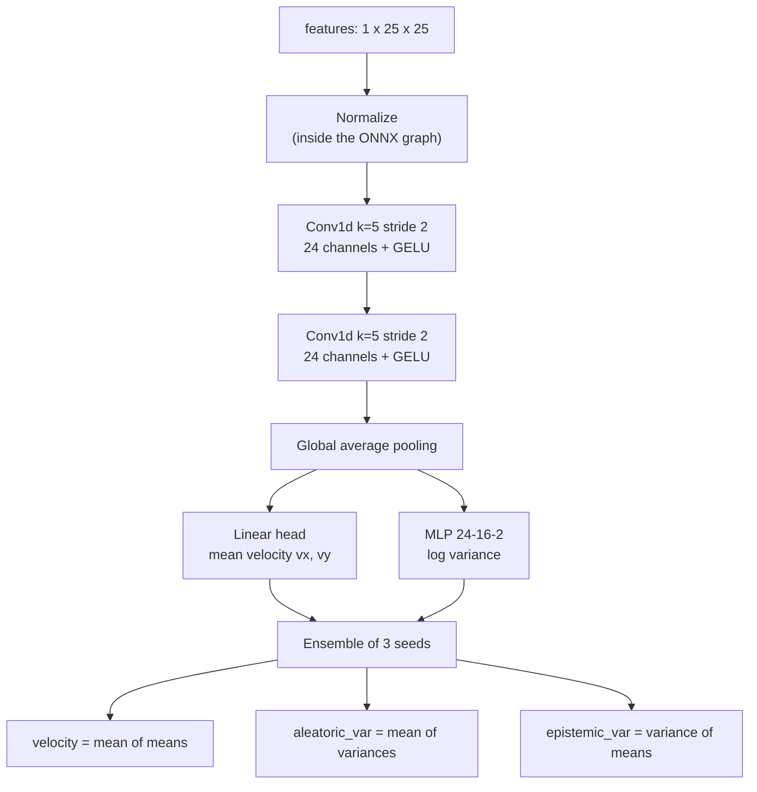
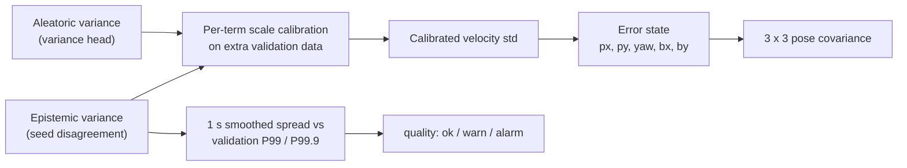
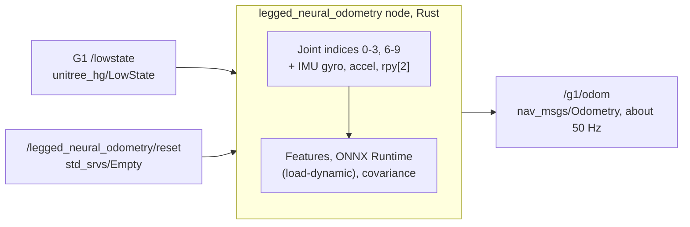
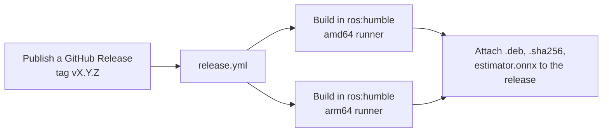

# Legged Neural Odometry

**English** | [简体中文](README.zh-CN.md)

[Usage](docs/usage.md) · [Method](docs/method.md) · [Development](docs/development.md) · [Evaluation report](reports/report.md) (Chinese) · [Changelog](CHANGELOG.md) · [Releases](../../releases)

Planar neural odometry for the Unitree G1 humanoid (29 DoF). The network takes raw IMU data and eight hip/knee
encoders and outputs the pelvis velocity `vx, vy` in the heading frame together with calibrated uncertainty.
The heading comes straight from the hardware IMU yaw. Integrating the velocity gives `x, y, yaw` and a 3x3 pose
covariance. A ROS 2 Humble node (Rust, ONNX Runtime) publishes it as `nav_msgs/Odometry` on `/g1/odom`.

> All training and evaluation data are generated in simulation with the official G1 walking policy. The web demo and
> tests use the ideal simulated attitude as the IMU yaw. The results are **not** a statement about accuracy on a real
> robot.


## What this repository does

```mermaid
flowchart LR
    A["Environment setup<br/>scripts/setup.sh"] --> B["Run official G1 policy<br/>in MuJoCo"]
    B --> C["Collect randomized<br/>trajectories"]
    C --> D["Audit data and labels"]
    D --> E["Train 3 TCN seeds<br/>+ variance heads"]
    E --> F["Calibrate uncertainty"]
    F --> G["Evaluate on locked<br/>test sets"]
    G --> H["releases/estimator.onnx"]
    H --> I["ROS 2 Humble package<br/>(.deb on GitHub Releases)"]
```



1. **Simulate**: the Unitree G1 model and velocity policy (`assets/unitree_g1/`) run in plain MuJoCo, no mjlab needed.
2. **Collect**: thousands of trajectories with randomized friction, mass, payload, PD gains, torque limits, sensor noise,
   pushes and yaw disturbances.
3. **Train and validate**: a tiny temporal CNN ensemble with uncertainty heads, calibrated on held-out data and tested
   once on locked test sets.
4. **Deploy**: the exported ONNX model is used by the Python runtime (`g1_odom.runtime.Odometry`), the web console and
   the ROS 2 node.

## Results

| Test set (evaluated once, after weights were locked) | Mean endpoint error | Pose 2σ coverage |
|---|---:|---:|
| `test_iid` (100 trajectories) | 2.76 cm | 96.2% |
| `odometry` (30 trajectories × 90 s) | 2.65 cm | 99.9% |
| `stop_test` (60 stop-and-go trajectories) | 2.23 cm | 96.2% |

The out-of-distribution set `test_ood` (low friction, heavy payload, low stiffness, reduced torque; 23 of 60
trajectories fall) has much larger errors and under-confident covariance. The disagreement between the seeds, however,
raises the `quality` flag on 41.3% of its frames (1.1% on `test_iid`), and it separates in- from out-of-distribution
data with an AUROC of 0.991. The full report is in [reports/report.md](reports/report.md) (Chinese).

## Quick start

### Inference only

Needs only `numpy`, `scipy` and `onnxruntime`:

```bash
git clone https://github.com/indunet/legged-neural-odometry.git && cd legged-neural-odometry
pip install -e .
```

```python
from g1_odom.runtime import Odometry
from g1_odom.sensors import SensorSample

odom = Odometry()   # loads releases/estimator.onnx
# yaw: hardware IMU yaw already expressed in the pelvis frame, in rad
result = odom.update(SensorSample(t, gyro, accel, q, dq, imu_yaw=yaw, imu_yaw_t=t))
# result is None (not ready yet) or a dict with velocity / pose / pose_cov / uncertainty / quality
```

Input and output conventions are in [docs/usage.md](docs/usage.md).

### Full environment (simulation, training, web console)

Linux, [uv](https://docs.astral.sh/uv/) and Python 3.12. Rendering without a GPU needs `libosmesa6`.

```bash
bash scripts/setup.sh            # CPU-only PyTorch (add --cuda for the CUDA build)
OPENBLAS_NUM_THREADS=1 .venv/bin/python -m pytest
scripts/run_web.sh               # http://127.0.0.1:18078
```

| Command | Purpose |
|---|---|
| `python -m g1_odom run --device cpu` | collect → audit → train → calibrate → evaluate, every stage is resumable |
| `python -m g1_odom collect` | collect simulation data only |
| `python -m g1_odom serve` | start the web console |
| `python -m g1_odom fetch --verify` | check `assets/unitree_g1/` against the locked hashes |

### ROS 2 Humble

Download `legged-neural-odometry_<version>_<arch>.deb` (`amd64` or `arm64`) from the
[Releases](../../releases) page:

```bash
sudo dpkg -i legged-neural-odometry_<version>_$(dpkg --print-architecture).deb
ros2 topic echo /g1/odom          # after /lowstate starts publishing
sudo dpkg -r legged-neural-odometry
```

The package installs into `/opt/legged-neural-odometry` and starts the `legged-neural-odometry.service` systemd unit.
From source: `colcon build --base-paths ros2 --packages-select unitree_hg legged_neural_odometry`
(needs ROS 2 Humble and Rust), or `bash scripts/build-deb.sh` to produce a package in `dist/`.

## How it works

### Signal chain



- **Features (25 per frame)**: mean gyro (3) and accelerometer (3) over each 20 ms, gravity direction in the body frame
  (3) from a gyro/accelerometer complementary filter, and the positions and velocities of the 8 hip and knee joints
  (16). The filter needs at least 0.75 s of standing still at start-up to calibrate the gyro bias and the gravity
  direction. Ankles are intentionally not used.
- **Heading**: the network never predicts yaw. Yaw is read from the hardware IMU, so the odometry does not accumulate
  gyro heading error. Missing or stale (> 20 ms) yaw is rejected instead of silently falling back to gyro integration.
- **Standstill gate**: a detector built from joint speeds, gyro norm and specific-force spread smoothly forces the
  velocity to zero while the robot stands, which removes drift at rest.

### Network



Each member is a temporal CNN with about 6k parameters, so inference takes microseconds on a CPU. Training uses
Huber loss, AdamW with a one-cycle schedule and whole-trajectory train/validation splits. The variance head is trained
afterwards with a Gaussian negative log-likelihood while the mean path is frozen. All three seeds are merged into one
ONNX graph. A 50-frame window was worse on validation data and is not used.

### Labels and lag compensation

The velocity target is not a raw finite difference. The recorded pelvis position is differenced, low-passed in the
world frame (time constant 0.2 s) and then rotated into the current heading frame. This filter would make the
integrated trajectory lag behind, so the integrator adds `(τ + dt/2) · (v_now − v_start)` (world frame), which cancels
the filter delay exactly. Integrating the labels reproduces the true position within 0.02 cm.

### Uncertainty and pose covariance



- Aleatoric noise (data-dependent) and epistemic uncertainty (disagreement between seeds) are scaled separately on the
  extra validation set so that velocity coverage matches the nominal 1σ/2σ levels.
- The pose covariance is propagated through the error state `[px, py, yaw, bx, by]`. `b` is a slowly varying velocity
  bias in units of the velocity standard deviation, the fast residual acts as white noise with the fitted correlation
  time, and yaw is a random walk whose 1σ after 60 s defaults to 1° (`yaw_drift_deg_min`, replace it with a measured
  value for real hardware).
- Covariances are only calibrated inside the training distribution. On out-of-distribution data they are too small,
  and the `quality` flag is the signal to trust: when it is `warn` or `alarm`, down-weight the odometry in a fusion
  filter or treat it purely as an alert.

### Simulation and data

- The robot walks with the official Unitree G1 velocity policy. As in the Unitree deployment code, the gait phase
  input is zeroed when the commanded speed norm is below 0.1, so the robot stands instead of stepping in place.
- 3110 fresh trajectories: 2000 general walking and 600 stop-and-go for training (split 90/10 by trajectory), 260 extra
  validation trajectories for model selection and calibration, and 100 IID, 60 OOD, 30 long and 60 stop-and-go test
  trajectories.
- Window length, mean source and all calibration parameters use only the extra validation set. Test sets are evaluated
  once after everything is locked.

### ROS 2 node



The node uses its own clock because `LowState` has no timestamp. A gap above 100 ms, time going backwards or a
non-finite value resets the estimator. Nothing is published until the standstill calibration and the first window are
complete. Messages are defined in `ros2/unitree_hg` (identical field layout to the Unitree `/lowstate`), so building and
running do not depend on the Unitree SDK. Details are in [docs/usage.md](docs/usage.md).

### Release pipeline



This is the only GitHub Actions workflow. It checks that the tag matches the version in `pyproject.toml`,
`Cargo.toml` and `package.xml` before building.

## Limitations

- Everything is trained and evaluated in simulation. Real gait, IMU mounting errors and latency are outside the
  training distribution; re-calibrate before trusting the covariance on hardware.
- The model is planar (flat ground) and takes no exteroceptive input.
- Stop or reset the odometry after a fall.

## Repository layout

```text
.
├── src/g1_odom/        Python package: simulation, data, training, evaluation, runtime, web console
├── ros2/               ROS 2 Humble: legged_neural_odometry (Rust node) and unitree_hg (messages)
├── assets/unitree_g1/  G1 model, meshes and walking policy from Unitree (see NOTICE.md)
├── releases/           released ONNX models, calibration and metadata
├── reports/            evaluation report and per-stage audits
├── configs/            resource config example and asset hash lock
├── scripts/            setup, web launcher, deb packaging, asset check, web smoke test
├── tests/              pytest suite
├── docs/               usage, method, development (English; Chinese in docs/zh-CN/)
└── data/ runs/ outputs/ dist/    generated locally, ignored by Git
```

## License and third-party assets

The code, released models and documentation are licensed under the [Apache License 2.0](LICENSE). The license does
**not** cover the Unitree robot model and walking policy in `assets/unitree_g1/`; their origin and terms are in
[NOTICE.md](NOTICE.md). Contributions are welcome, see [CONTRIBUTING.md](CONTRIBUTING.md).
