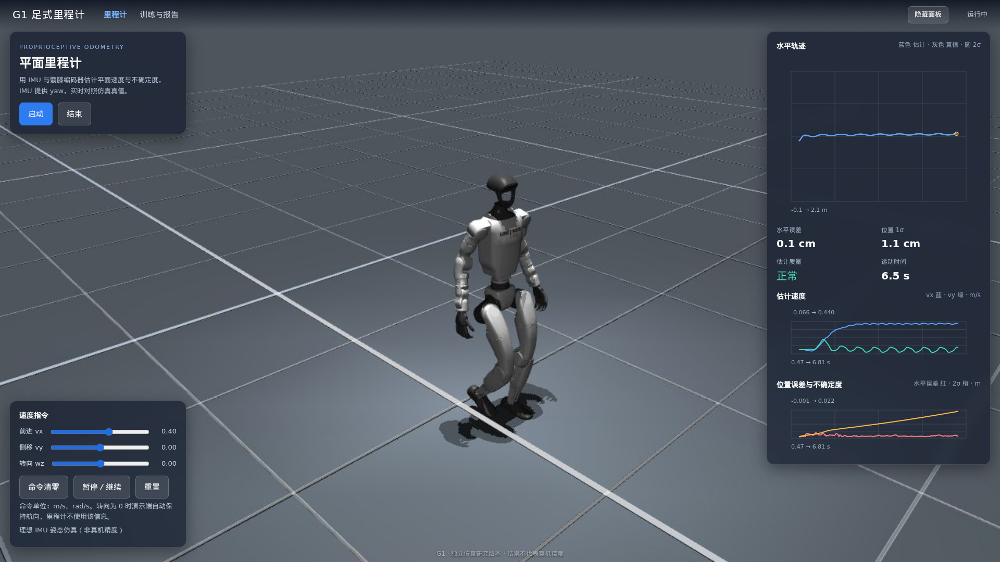
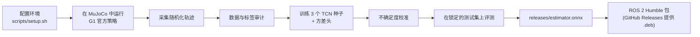
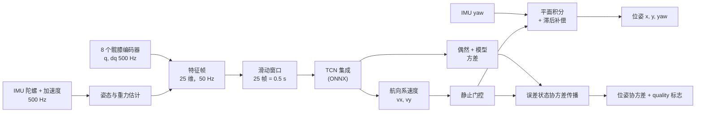
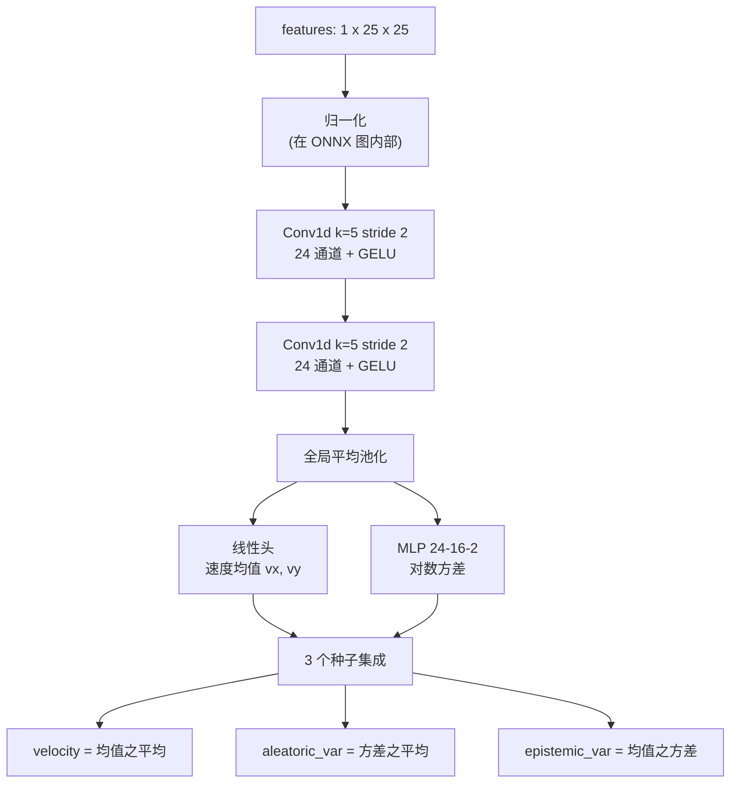
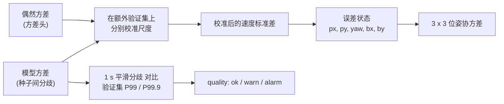
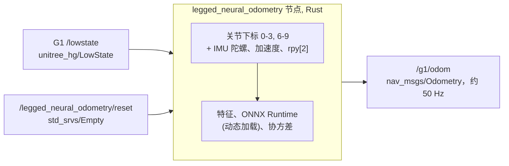
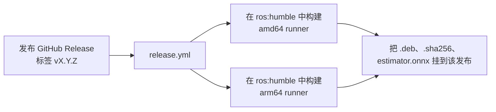

# Legged Neural Odometry：G1 神经网络足式里程计

[English](README.md) | **简体中文**

[使用方法](docs/zh-CN/usage.md) · [方法说明](docs/zh-CN/method.md) · [开发与复现](docs/zh-CN/development.md) · [评测报告](reports/report.md) · [更新日志](CHANGELOG.md) · [发布页](../../releases)

Unitree G1（29 自由度）人形机器人的平面神经网络里程计。网络输入原始 IMU 与八个髋膝编码器，输出骨盆航向坐标系下的速度
`vx, vy` 及校准后的不确定度；航向直接读取硬件 IMU 的 yaw。对速度积分得到 `x, y, yaw` 和 3x3 位姿协方差。
ROS 2 Humble 节点（Rust + ONNX Runtime）把结果以 `nav_msgs/Odometry` 发布在 `/g1/odom`。

> 全部训练与评测数据由仿真中的宇树官方 G1 步行策略生成。Web 演示与测试用理想仿真姿态模拟 IMU 的 yaw。
> 结果**不代表**真机精度。



## 这个项目做什么



1. **仿真**：宇树 G1 模型与 velocity 策略（`assets/unitree_g1/`）直接在普通 MuJoCo 中运行，不需要 mjlab。
2. **采集**：数千条轨迹，随机化摩擦、质量、负载、PD、力矩上限、传感器噪声、推力与偏航扰动。
3. **训练与验证**：极小的时间卷积网络集成，带不确定度头；在留出数据上校准，在锁定的测试集上只评测一次。
4. **部署**：导出的 ONNX 由 Python 运行时（`g1_odom.runtime.Odometry`）、Web 控制台和 ROS 2 节点共同使用。

## 结果

| 测试集（锁定权重后只评测一次） | 终点均值 | 位姿 2σ 覆盖 |
|---|---:|---:|
| `test_iid`（100 条） | 2.76 cm | 96.2% |
| `odometry`（30 条 × 90 s） | 2.65 cm | 99.9% |
| `stop_test`（60 条启停） | 2.23 cm | 96.2% |

分布外组合工况 `test_ood`（低摩擦、重负载、低刚度、扭矩折减，60 条中 23 条跌倒）误差明显更大，协方差也偏小；
但种子间分歧会让 41.3% 的帧触发 `quality` 告警（`test_iid` 只有 1.1%），区分分布内外的 AUROC 为 0.991。
完整结果见 [reports/report.md](reports/report.md)。

## 快速开始

### 仅推理

只需要 `numpy`、`scipy`、`onnxruntime`：

```bash
git clone https://github.com/indunet/legged-neural-odometry.git && cd legged-neural-odometry
pip install -e .
```

```python
from g1_odom.runtime import Odometry
from g1_odom.sensors import SensorSample

odom = Odometry()   # 加载 releases/estimator.onnx
# yaw：硬件 IMU 输出、已变换到骨盆坐标系的 yaw，单位 rad
result = odom.update(SensorSample(t, gyro, accel, q, dq, imu_yaw=yaw, imu_yaw_t=t))
# result 为 None（尚未就绪）或含 velocity / pose / pose_cov / uncertainty / quality 的字典
```

输入输出约定见 [docs/zh-CN/usage.md](docs/zh-CN/usage.md)。

### 完整环境（仿真、训练、Web 控制台）

Linux、[uv](https://docs.astral.sh/uv/)、Python 3.12。无 GPU 渲染需要系统库 `libosmesa6`。

```bash
bash scripts/setup.sh            # CPU 版 PyTorch（加 --cuda 安装 CUDA 版）
OPENBLAS_NUM_THREADS=1 .venv/bin/python -m pytest
scripts/run_web.sh               # http://127.0.0.1:18078
```

| 命令 | 作用 |
|---|---|
| `python -m g1_odom run --device cpu` | 采集 → 审计 → 训练 → 校准 → 评测，每个阶段可中断恢复 |
| `python -m g1_odom collect` | 只采集仿真数据 |
| `python -m g1_odom serve` | 启动 Web 控制台 |
| `python -m g1_odom fetch --verify` | 校验 `assets/unitree_g1/` 与锁定哈希一致 |

### ROS 2 Humble

从[发布页](../../releases)下载 `legged-neural-odometry_<version>_<arch>.deb`（`amd64` 或 `arm64`）：

```bash
sudo dpkg -i legged-neural-odometry_<version>_$(dpkg --print-architecture).deb
ros2 topic echo /g1/odom          # /lowstate 开始发布之后
sudo dpkg -r legged-neural-odometry
```

包安装到 `/opt/legged-neural-odometry`，并启动 `legged-neural-odometry.service`。
源码构建：`colcon build --base-paths ros2 --packages-select unitree_hg legged_neural_odometry`（需要 ROS 2 Humble 与 Rust），
或运行 `bash scripts/build-deb.sh`，在 `dist/` 下生成 deb 包。

## 技术原理

### 信号链



- **特征（每帧 25 维）**：每 20 ms 内陀螺（3）与加速度（3）的均值，由陀螺／加速度互补滤波得到的机体系重力方向（3），
  以及 8 个髋膝关节的位置与速度（16）。启动时需要至少 0.75 s 静止，用来标定陀螺零偏和重力方向。脚踝刻意不使用。
- **航向**：网络从不预测 yaw，航向直接读硬件 IMU，因此里程计不会累积陀螺航向误差。yaw 缺失或过期（> 20 ms）会被拒绝，
  不会悄悄退回陀螺积分。
- **静止门控**：由关节速度、陀螺模长和比力波动构成的检测器，在机器人站定时平滑地把速度压到零，消除静止漂移。

### 网络结构



每个成员是约 6k 参数的时间卷积网络，在 CPU 上推理只需几微秒。训练使用 Huber 损失、AdamW + OneCycle 学习率，
按整条轨迹划分训练／验证集。方差头在冻结均值路径后用高斯负对数似然单独训练，三个种子合并为一张 ONNX 图。
50 帧窗口在验证集上更差，未采用。

### 标签与滞后补偿

速度标签不是原始差分：先对记录的骨盆位置差分，在世界坐标系做 0.2 s 一阶低通，再旋转到当前航向系。
这个滤波会让积分轨迹滞后，所以积分端加上 `(τ + dt/2) · (v_now − v_start)`（世界系），精确抵消滤波延迟。
把标签当作网络输出积分，位置误差小于 0.02 cm。

### 不确定度与位姿协方差



- 偶然噪声（与数据相关）和模型不确定度（种子间分歧）分别在额外验证集上校准尺度，使速度覆盖率对齐名义的 1σ／2σ。
- 位姿协方差按误差状态 `[px, py, yaw, bx, by]` 传播。`b` 是以速度标准差为单位的慢变偏置，其余快变部分按拟合的相关时间
  等效为白噪声；yaw 为随机游走，默认 60 秒 1σ = 1°（`yaw_drift_deg_min`，真机上应换成实测值）。
- 协方差只在训练分布内校准过。分布外时数值偏小，应以 `quality` 标志为准：`warn` 或 `alarm` 时，融合端应降低里程计权重，
  或只把它当作告警。

### 仿真与数据

- 机器人使用宇树官方 G1 velocity 策略行走。与宇树部署代码一致，指令速度范数小于 0.1 时步态相位输入置零，机器人站定，
  而不是原地踏步。
- 3110 条全新轨迹：训练池 2000 条通用行走 + 600 条启停（按整轨迹 90/10 划分），260 条额外验证轨迹用于选模与校准，
  测试集为 100 条 IID、60 条 OOD、30 条长轨迹和 60 条启停。
- 窗口、均值来源和全部校准参数只用额外验证集；测试集在全部锁定后只评测一次。

### ROS 2 节点



`LowState` 没有时间戳，节点使用自己的时钟。间隔超过 100 ms、时间倒退或出现非有限值时会重置估计器；
静止标定和第一个窗口完成之前不发布任何消息。消息定义在 `ros2/unitree_hg`（字段与宇树 `/lowstate` 完全一致），
所以编译和运行都不依赖宇树 SDK。详见 [docs/zh-CN/usage.md](docs/zh-CN/usage.md)。

### 发布流程



这是仓库里唯一的 GitHub Actions 工作流。构建前会检查标签与 `pyproject.toml`、`Cargo.toml`、`package.xml` 中的版本一致。

## 局限

- 全部在仿真中训练与评测。真机步态、IMU 安装误差和时延不在训练分布内；上真机前请重新校准协方差。
- 模型是平面（平地）的，没有外部感知输入。
- 跌倒后应停止或重置里程计。

## 目录结构

```text
.
├── src/g1_odom/        Python 包：仿真、数据、训练、评测、运行时、Web 控制台
├── ros2/               ROS 2 Humble：legged_neural_odometry（Rust 节点）与 unitree_hg（消息）
├── assets/unitree_g1/  宇树提供的 G1 模型、网格和步行策略（见 NOTICE.md）
├── releases/           发布的 ONNX 模型、校准参数与元数据
├── reports/            评测报告与各阶段审计结果
├── configs/            资源配置示例与资源哈希锁定清单
├── scripts/            安装、Web 启动、deb 打包、资源校验、Web 冒烟测试
├── tests/              pytest 测试
├── docs/               使用、方法、开发文档（英文；中文在 docs/zh-CN/）
└── data/ runs/ outputs/ dist/    本地生成目录（Git 忽略）
```

## 许可证与第三方资源

本项目代码、发布的模型与文档采用 [Apache License 2.0](LICENSE)。该许可证**不适用于** `assets/unitree_g1/` 里的宇树机器人模型和步行策略，
其来源和条款见 [NOTICE.md](NOTICE.md)。欢迎贡献，请先阅读 [CONTRIBUTING.md](CONTRIBUTING.md)（英文）。
